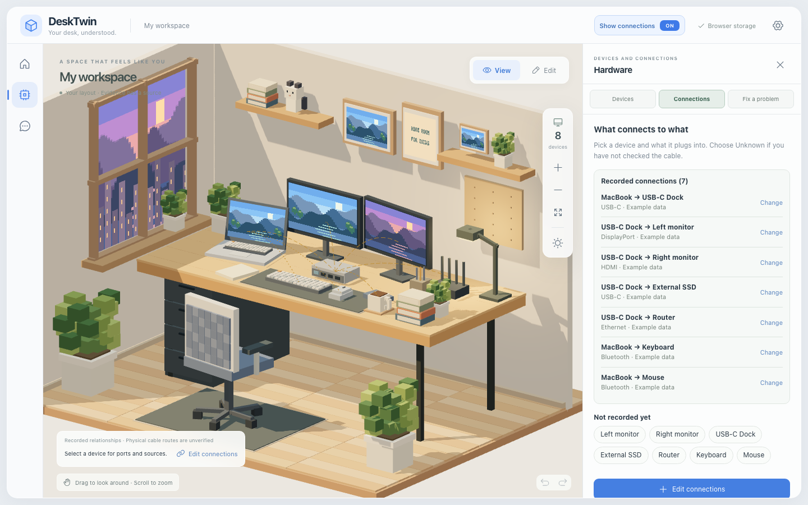
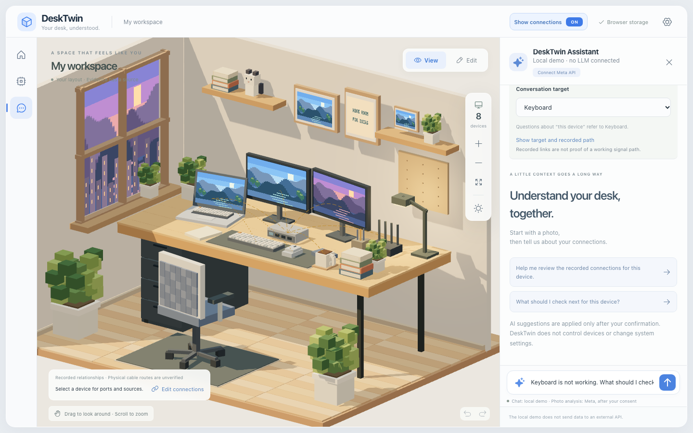
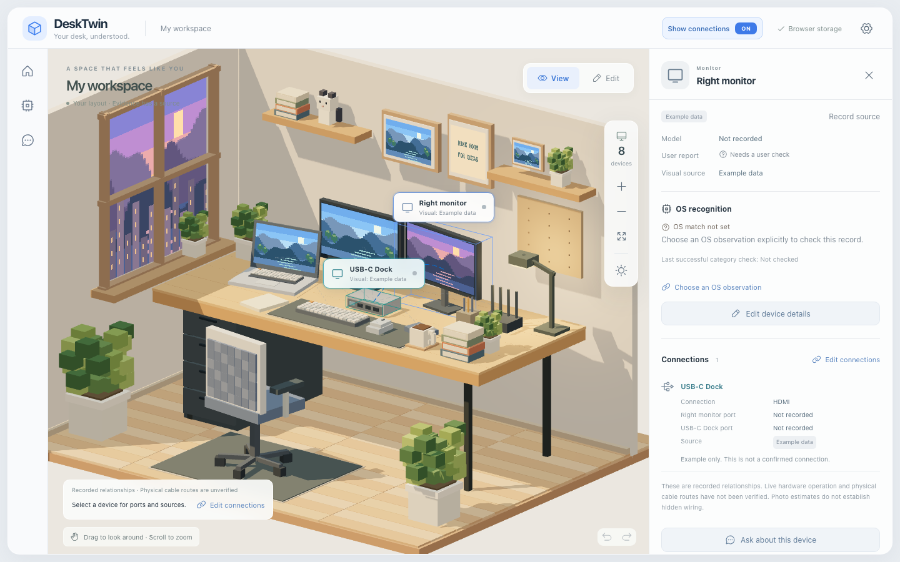
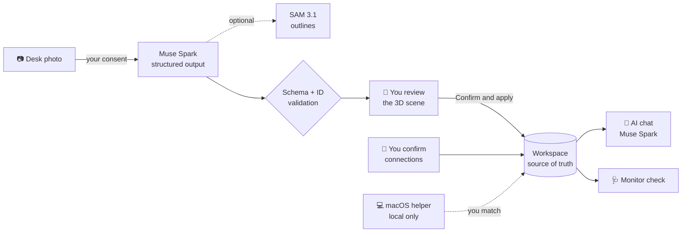

<div align="center">

# 🖥️ DeskTwin

### Your desk, understood.

**Snap a photo of your desk → get an editable 3D twin → record what's plugged into what → fix problems with Meta AI.**

[](https://cerebralvalley.ai/e/meta-ai-developer-hackathon/details)
[](https://dev.meta.ai/docs/structured-output)
[](#-how-meta-models-power-it)
[](LICENSE)
<br/>


[Quick start](#-quick-start) · [How it works](#-how-it-works) · [Meta models](#-how-meta-models-power-it) · [Architecture](#-architecture) · [한국어](README.ko.md)



<sub>Sample desk shown. Its devices and links are placeholders until you start your own desk.</sub>

</div>

---

## 💡 Why DeskTwin?

One monitor goes black on a desk with a laptop, a dock, two screens and a pile of USB and Bluetooth gear. A photo shows _what_ is there, but not _what is plugged into what_. A chatbot just guesses.

DeskTwin gives the AI a **map of your actual setup** and keeps facts and guesses apart:

|                             | Comes from                                  | Never treated as                        |
| --------------------------- | ------------------------------------------- | --------------------------------------- |
| 📷 **Photo interpretation** | Muse Spark reading your desk photo          | Proof that a device exists or is cabled |
| 🙋 **Your report**          | You confirm a link or a device status       | Proof that the link works               |
| 💻 **macOS observation**    | Optional, consented, local display/USB scan | Proof of cable routes or working parts  |

> **Nothing the model suggests is saved until you confirm it.** Saving a cable never marks a device as working.

## ✨ How it works

<table>
  <tr>
    <td width="50%" valign="top">
      
      <h4>1. 📷 Photo → 3D twin</h4>
      Muse Spark finds the objects on your desk (optionally outlined by SAM 3.1). You choose what to keep, review the 3D layout, and apply it.
    </td>
    <td width="50%" valign="top">
      
      <h4>2. 🔌 Record what connects to what</h4>
      Devices without a link show up as chips. Tap one, pick what it plugs into and the cable (or <i>Unknown</i>), and save.
    </td>
  </tr>
  <tr>
    <td width="50%" valign="top">
      
      <h4>3. 🛠️ Fix a problem with AI chat</h4>
      Pick the device that isn't working. AI chat opens with a draft question grounded in your recorded links. Nothing is sent until you press Send.
    </td>
    <td width="50%" valign="top">
      
      <h4>4. 🩺 Inspect & troubleshoot</h4>
      Every device shows its sources, ports and links. Monitors get a step-by-step check along the recorded monitor → dock → computer route.
    </td>
  </tr>
</table>

**Plus:** ✏️ an Edit mode with collision-aware drag, surface placement and box-part shape editing · ↩️ 20-step Undo/Redo · 💻 optional local macOS display/USB matching · 📦 JSON import/export with no photos, chat or keys inside.

## 🧠 How Meta models power it

| Model                              | Role in DeskTwin                                                                                                                                                           |
| ---------------------------------- | -------------------------------------------------------------------------------------------------------------------------------------------------------------------------- |
| **Muse Spark** `muse-spark-1.3`    | 📷 Reads the desk photo and proposes objects with kind, rough position, size, color and box parts. 💬 Answers questions about a selected device using your recorded setup. |
| **SAM 3.1** `sam-3.1` _(optional)_ | ✂️ With two-stage analysis on, outlines each chosen object in the photo so you can see exactly what was found.                                                             |
| **Muse Image**                     | 🎨 Generated the demo desk image used in the video. Generated images are not committed.                                                                                    |

**Guardrails on every response:**

- ✅ A **strict JSON schema** and existing device IDs are required before anything is shown.
- 🚫 Photo responses may describe visible objects only. Connection, status and executable fields are rejected.
- 🔑 The API key stays server-side in `.env` (never in `VITE_*`).
- 🧪 No key? The same workflow runs as a **clearly labeled local demo** that never pretends to be a model.

## 🚀 Quick start

> Requires **Node.js 22.12+**

```bash
git clone https://github.com/junjunjunbong/DeskTwin.git
cd DeskTwin
npm ci
npm run dev
```

Open **http://127.0.0.1:5173**. Without a key this is the offline local demo, and no external calls are made.

<details>
<summary><b>🔑 Connect Meta models</b></summary>

```bash
cp .env.example .env
```

```dotenv
MODEL_API_KEY=your_key_here
META_BASE_URL=https://api.meta.ai/v1
META_MODEL=muse-spark-1.3
# Optional: two-stage photo analysis + SAM 3.1 outlines
META_PHOTO_TWO_STAGE=false
META_SAM_ENABLED=false
META_SAM_MODEL=sam-3.1
```

Restart the server, then open **AI chat → Connect Meta API**, review what will be sent, and enable it. Real calls may cost money. The local 20 requests/minute limit is not a spending cap.

</details>

<details>
<summary><b>💻 macOS hardware matching (optional)</b></summary>

Requires macOS 12+ and Xcode Command Line Tools.

```bash
npm run hardware:build
MODEL_API_KEY='' npm run dev
```

Open **Hardware → Devices → Open Mac hardware details**, agree to the local read, and press **Start detection**. You match each observation to a desk device yourself. Serial numbers become an installation-specific HMAC inside the native process and never leave the machine. Bluetooth live detection is not supported. See [MACOS_HARDWARE.md](docs/MACOS_HARDWARE.md).

</details>

<details>
<summary><b>🔧 Custom ports</b></summary>

```bash
MODEL_API_KEY='' DESKTWIN_WEB_PORT=5187 PORT=4337 npm run dev
```

</details>

## 🧩 Architecture



| Path                      | What lives there                                          |
| ------------------------- | --------------------------------------------------------- |
| `src/domain/workspace.ts` | Source of truth: schema, commands, validation             |
| `src/components/`         | Three.js voxel scene, panels and dialogs                  |
| `server/`                 | Local API, origin checks, Meta client (`server/meta.ts`)  |
| `native/`                 | macOS display/USB helper                                  |
| `tests/`                  | Playwright end-to-end tests with mocked Meta and hardware |

More in [ARCHITECTURE.md](docs/ARCHITECTURE.md).

## 🔒 Privacy by design

- 📷 Photos stay in memory unless you explicitly send one for analysis. They are never written to storage or JSON.
- 💬 Chat sends the current message, up to 12 recent Meta-mode turns and the shareable device and link records. macOS observations and hardware identities are **never** sent.
- 💾 Your workspace lives in your browser. Details in [PRIVACY.md](docs/PRIVACY.md).

## 🧪 Development

```bash
npm run check            # TypeScript + unit/API tests + production build
npx playwright install chromium
npm run test:e2e         # Chromium UI tests (own servers, empty API key)
npm run test:production  # production server + browser test
```

Every test mocks Meta requests, so no API credit is spent. Busy ports: `DESKTWIN_TEST_PORT=5187 DESKTWIN_TEST_API_PORT=4337 npm run test:e2e`.

<details>
<summary><b>📋 What was verified, and what was not</b></summary>

- **Live Meta calls (2026-11-04):** a conversation request succeeded in 14.3 s. On a Muse Image demo desk, two-stage photo analysis reached a scene that could be applied. On a real desk photo, analysis returned 17 objects, but 4–5 overlaps (monitor, riser, stand) still need manual fixes before applying. Photo limits are 120 s on the server and 125 s in the browser. See [PHOTO_TWO_STAGE.md](docs/PHOTO_TWO_STAGE.md) and [PHOTO_EVALUATION.md](docs/PHOTO_EVALUATION.md).
- **Not claimed:** guided step-by-step checks exist for monitors only; other devices go to AI chat. Physical Mac re-verification of the hardware helper, Bluetooth live discovery, Windows/Linux helpers, multi-user hosting and cloud sync are out of scope.
- This is a single-user local MVP. Don't expose the server to the public internet.

</details>

<details>
<summary><b>📚 More docs</b> (some in Korean)</summary>

[Scene editor](docs/SCENE_EDITOR.md) · [Storage](docs/STORAGE.md) · [Photo review](docs/PHOTO_REVIEW.md) · [Photo reference fitting](docs/PHOTO_REFERENCE_FITTING.md) · [Hackathon notes](docs/HACKATHON.md) · [Submission script](docs/SUBMISSION.md) · [Contributing](CONTRIBUTING.md)

</details>

## 🏆 Built at the Meta AI Developer Hackathon

This repository was started during the [Meta AI Developer Hackathon](https://cerebralvalley.ai/e/meta-ai-developer-hackathon/details), and every commit is from 2026-10-26 or later. The workspace, photo-to-3D flow, connection recording, troubleshooting, local Mac matching boundary and Meta structured-output integration were all built during the event.

## 📄 License

[MIT](LICENSE). Scene geometry and textures are generated by code, and no third-party 3D models or user photos are shipped. `libheif-js` (LGPL-3.0) is used for local HEIC conversion; see [THIRD_PARTY_NOTICES.txt](public/THIRD_PARTY_NOTICES.txt).

<div align="center">
<sub>Made with 🧡 and a lot of cables.</sub>
</div>
