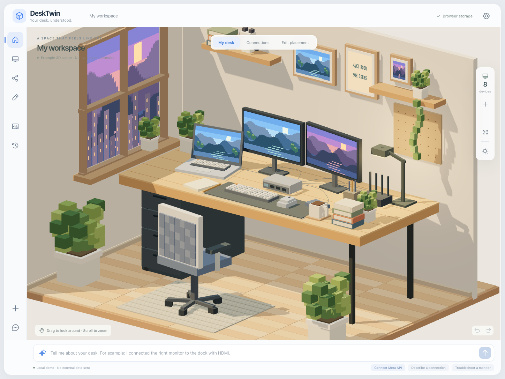

# DeskTwin

**Your desk, understood.** 사진과 대화로 구성하는 나만의 작업 공간.

DeskTwin은 책상을 넓게 보여주는 **실제 3D voxel 작업실**과, 기기·연결 관계를 함께 수정하는 workspace companion입니다. 그림을 배경으로 붙인 UI가 아닙니다. Three.js 장면에서 기기와 가구·소품을 선택하고, 위치·회전·크기·색을 편집하며 연결을 기록할 수 있습니다.



> **현재 단계: local-first MVP.** 기본 실행은 외부 API를 호출하지 않는 규칙 기반 데모입니다. Meta API 연결 코드는 구현되어 있지만, 실제 키를 이용한 live 호출 및 모델 정확도 평가는 아직 완료하지 않았습니다. OS 하드웨어 감지는 구현하지 않았습니다.

## 빠르게 실행하기

Node.js 22.12 이상이 필요합니다. 이번 검증 환경은 Node.js 24.22.1과 Chromium입니다. 의존성 버전은 `package-lock.json`에 고정되어 있습니다.

```bash
git clone https://github.com/junjunjunbong/DeskTwin.git
cd DeskTwin
npm ci
npm run dev
```

브라우저에서 **http://127.0.0.1:5173**을 엽니다. API 서버는 `127.0.0.1:4318`에서 실행합니다. 두 서버 모두 기본적으로 로컬 컴퓨터에서만 접근할 수 있습니다.

다른 작업에서 이 포트를 사용 중이면 별도 포트로 실행할 수 있습니다. `DESKTWIN_WEB_PORT`는 UI 서버, `PORT`는 API 서버와 UI의 API proxy를 지정합니다. 다음 예시는 API 키를 비운 로컬 데모입니다.

```bash
MODEL_API_KEY='' DESKTWIN_WEB_PORT=5187 PORT=4337 npm run dev
# http://127.0.0.1:5187
```

UI 포트가 이미 사용 중이면 실행이 실패합니다. 다른 포트로 자동 이동하거나 기존 서버를 재사용하지 않습니다.

저장소가 비공개인 동안에는 접근 권한과 GitHub 인증이 필요합니다. 라이선스 추가나 이 구현으로 저장소 공개 상태를 변경하지 않았습니다.

## 지금 사용할 수 있는 기능

| 영역       | 구현 내용                                                                             |
| ---------- | ------------------------------------------------------------------------------------- |
| 작업실     | 실제 3D 장면, 회전·확대, 낮·오후·밤 조명, 선택 시 기기 라벨                           |
| 장면 편집  | 기기·가구·소품의 충돌 방지, 표면 배치, 책상 연결·분리, 위치·회전·크기·색·부품 편집    |
| 연결 구성  | 독립적인 Show connections ON/OFF, 연결 상대·선 강조, 기기 이름·방식·포트·출처 확인    |
| 대화       | 로컬 규칙 기반 예시, Meta structured-output 연결, 제안 확인·취소                      |
| 사진       | 별도 전송 동의, 사용자 설명을 포함한 장면 제안, 저장되지 않는 3D 편집·검토, 전체 승인 |
| 문제 확인  | 모니터 점검 단계와 사용자 응답 기록. 원인을 자동 확정하지 않음                        |
| 저장       | 탭 간 저장 충돌 방지, v1/v2 호환 읽기, JSON 가져오기·내보내기, 20단계 Undo/Redo       |
| 인터페이스 | 키보드 접근 가능한 목록·폼, 모바일 레이아웃, WebGL 실패 안내                          |

사진 분석은 **보이는 물체의 종류·대략적 배치·색·크기**를 구조화된 데이터로 제안합니다. 별도 3D 미리보기에서 물체를 수정하고 **Confirm and apply scene**을 눌러야 저장됩니다. 취소하면 현재 구성은 그대로 남습니다. 적용 한 번은 Undo 한 단계입니다.

기존 코드 기반 voxel 도형을 재사용하며, 렌더링과 충돌 계산이 같은 부품 데이터를 사용합니다. 빠른 드래그도 이동 경로를 검사하고, 숫자로 지정한 회전·크기가 다른 물체와 충돌하면 이전 값을 유지합니다. **Place on surface**로 바닥·책상 위에 놓고, **Attach to desk**로 책상과 함께 이동·회전하도록 연결할 수 있습니다. 개별 이동과 **Detach from desk**도 가능합니다.

바닥이나 책상에 놓인 물체의 크기를 바꿀 때는 기존 접촉 높이를 유지합니다. 물체 원점과 실제 하단이 달라도 크기 변경만으로 책상을 뚫거나 공중으로 들리지 않도록 보정합니다. 사용자가 높이를 직접 지정한 경우에는 그 입력을 그대로 검사합니다.

**Customize template shape**로 모든 기기·가구 템플릿을 편집 가능한 box 부품으로 바꿀 수 있습니다. 부품의 위치·크기·3축 회전·색을 수정하고 추가·복제·삭제합니다. 사용자는 최대 128개 부품을 저장할 수 있으며, 사진 모델은 최대 32개의 부품으로 형태를 제안할 수 있습니다. 지원하지 않는 물체도 Generic object로 근사합니다. AI 코드는 실행하지 않습니다.

사진의 **Device record**에서 기존 기기 매칭을 확인하거나 별도의 새 기기로 바꿀 수 있습니다. 이전 사진 ID와 고유한 이름을 재사용해 반복 분석의 중복을 줄입니다. 같은 종류의 기존 기기가 있지만 매칭을 결정할 수 없으면 **기존 기기 또는 별도의 새 기기를 명시적으로 선택하기 전에는 적용할 수 없습니다.** 기존 예시 기기에 사용자가 기록한 연결이 있어도 해당 기기와 연결을 보존합니다. 기존 이름·모델·작동 상태도 유지하고 새 기기의 상태는 `unknown`으로 둡니다.

두 탭의 변경이 충돌하면 오래된 탭은 최신 저장을 덮어쓰지 않고 자신의 화면을 유지합니다. 필요한 경우 그 탭의 구성을 내보낸 뒤 **Load latest saved workspace**로 최신 구성을 불러옵니다. 안전한 저장은 Web Locks를 지원하는 HTTPS 또는 localhost 브라우저 환경을 사용합니다. 이름과 숫자는 Enter 또는 포커스 이동 때 저장됩니다.

저장 형식은 별도 wrapper가 없는 Workspace v2 JSON이며, 기존 `desktwin.workspace.v1` 저장 키를 유지합니다. v1/v2 저장본과 JSON을 읽을 수 있고, 읽기나 마이그레이션만으로 원본을 다시 저장하지 않습니다. Web Locks를 지원하지 않는 환경에서는 편집 저장을 막고 JSON 내보내기를 제공합니다.

바닥·벽·창문과 조명 구조는 고정된 예시 room shell입니다. 중력·균형·정밀한 실측을 계산하는 물리 시뮬레이션은 아닙니다. [장면 편집 범위와 데이터 형식](docs/SCENE_EDITOR.md), [저장 충돌 처리](docs/STORAGE.md)를 참고하세요.

## 연결 정보는 어떻게 믿나요?

상단 **Show connections**는 **Edit placement**에서도 켜고 끌 수 있습니다. ON은 Bluetooth를 포함한 모든 기록된 관계를 표시합니다. OFF는 선만 숨기며 연결 기록과 Undo 기록을 변경하지 않습니다. **Connections** 탭을 열면 ON이 되고, 다른 모드로 이동해도 선택한 표시 상태를 유지합니다.

기기를 선택하면 연결된 상대 기기와 관련 선을 강조합니다. 나머지 선도 계속 표시합니다. 책상이나 소품을 선택해도 모든 기기 연결선이 남습니다. 상세 패널에서는 상대 기기 이름, 연결 방식, 양쪽에 입력한 포트, 정보 출처와 메모를 확인하고 상대 기기를 선택할 수 있습니다. 선을 켠 채 드래그하면 선의 끝점도 기기를 따라 움직입니다.

이 선은 **저장된 관계를 읽기 쉽게 표시한 것**입니다. 실제 포트의 물리 위치, 케이블 경로, 전기적 연결, 협상된 기능이나 작동 상태를 확인한 표시가 아닙니다. 표시 토글은 화면 상태이며 저장본이나 내보낸 JSON에 추가하지 않습니다.

`source`와 `status`는 서로 다른 필드입니다. v2의 `visual.source`는 위치·크기·색의 출처를 별도로 기록합니다. 시각적 속성을 수정해도 기기 작동 상태는 바뀌지 않습니다.

| 출처             | 의미                                             |
| ---------------- | ------------------------------------------------ |
| `demo`           | 체험을 위한 예시. 실제 사용자 기기라는 뜻이 아님 |
| `user-reported`  | 사용자가 직접 입력하거나 확인한 구성             |
| `photo-inferred` | 사진의 시각적 특징에서 추정한 기기               |

작동 상태는 `unknown`, `reported-working`, `reported-issue`로 구분합니다. **케이블을 연결했다고 알려주는 것만으로 상태가 정상으로 바뀌지 않습니다.** 모델 제안도 사용자가 확인하기 전까지 상태에 반영하지 않습니다.

처음 표시되는 8개 기기와 7개 연결은 모두 예시입니다. 사진 패널의 **Remove sample devices and start my setup**으로 예시만 제거하고 자신의 기기를 추가할 수 있습니다.

## Meta 연결

공식 Meta API 문서에서 확인한 기본값은 `https://api.meta.ai/v1`과 `muse-spark-1.3`입니다. 실제 계정에서 사용 가능한 모델과 API 조건은 설정할 때 다시 확인하세요.

```bash
cp .env.example .env
```

`.env`를 로컬에서 편집합니다. 키를 GitHub, 채팅, 스크린샷에 넣지 마세요.

```dotenv
MODEL_API_KEY=your_key_here
META_BASE_URL=https://api.meta.ai/v1
META_MODEL=muse-spark-1.3
PORT=4318
```

API 서버를 재시작한 뒤 화면 아래 **Connect Meta API**를 엽니다. 전송 내용을 확인하고 활성화해야 다음 대화부터 실제 모델을 호출합니다. 키가 설정되어 있다는 사실은 API 호출 성공을 검증한 것과 다릅니다.

- 대화 전송: 현재 메시지, 최근 대화 최대 12개, 기기·연결 구성.
- 사진 전송: 사진 패널에서 별도 동의하고 분석 버튼을 누른 경우에만 축소된 사진, 기기·연결·장면 구성, 입력한 설명을 전송합니다. 설명은 시각적 제안의 문맥이며 연결을 자동 저장하지 않습니다.
- 모델 제안은 strict JSON schema와 존재하는 기기 ID를 검증한 후 표시합니다. 사진 응답에는 시각적 속성만 허용하며 연결·status·실행 코드 필드는 거부합니다.
- 오류가 나면 실제 오류를 표시합니다. 실패한 live 응답을 성공한 AI 데모로 가장하지 않습니다.
- 실제 API 호출은 비용이 발생할 수 있습니다. 로컬 20 requests/minute 제한은 과금 상한이 아닙니다.

코드는 공식 Meta API 호스트만 허용합니다. 다른 provider, 로컬 open-weight 서버, BYOK 웹 서비스는 이번 MVP 범위가 아닙니다.

## 사진에서 편집 가능한 장면 만들기

1. **Desk photo**에서 사진을 선택합니다. 선택만으로는 전송하지 않습니다.
2. 알고 있는 기기나 연결 설명을 입력하고 별도 Meta 전송 동의를 확인합니다.
3. **Create scene preview with Meta**를 누릅니다. 서버 key가 설정된 경우 실제 API 비용이 발생할 수 있습니다.
4. **Review your desk scene**에서 물체와 기기 매칭을 확인하고, 충돌을 검사하는 배치·표면·책상 연결·부품 편집기로 조정합니다. **Review device record** 안내가 있으면 기존 기기 또는 별도의 새 기기를 선택합니다.
5. **Confirm and apply scene**으로 한 번에 적용하거나 **Discard preview**로 취소합니다.
6. **Scene objects**에서 이후에도 가구·소품을 편집합니다. 기기는 **Edit placement**에서 배치·연결·부품을 수정합니다.
7. 변경은 브라우저에 저장됩니다. 설정의 **Export JSON**과 **Import JSON**으로 구성을 옮길 수 있습니다. 기존 v1 저장본과 JSON은 v2로 읽으며, 사진·대화·key는 JSON에 포함하지 않습니다.

사진 분석의 모델 인식 품질과 live API 성공은 아직 검증하지 않았습니다. 아래 테스트에서는 응답을 mock으로 대체합니다.

## 데모 순서

1. 기본 화면에서 회전·확대로 책상을 살펴봅니다.
2. **Show connections**를 켜고 **Device list**에서 Dock을 선택해 상대 기기, 포트와 출처를 확인합니다.
3. 선을 켠 채 **Edit placement**에서 기기를 드래그하거나 좌우·앞뒤·회전·크기 값을 조절합니다.
4. 대화창에 `I connected the right monitor to the dock with HDMI`를 입력합니다.
5. **Confirm and apply**를 눌러야 연결이 `user-reported`로 바뀝니다.
6. 오른쪽 모니터를 선택하고 **Troubleshoot monitor step by step**을 시작합니다.
7. 직접 테스트한 결과를 답하고, 필요하면 사용자 보고로 저장합니다.
8. 설정에서 구성을 JSON으로 내보냅니다.

로컬 데모는 위와 같은 제한된 표현만 처리합니다. 자유로운 대화와 실제 사진 분석은 Meta 연결을 사용합니다.

## Production 실행

```bash
npm run build
npm start
```

**http://127.0.0.1:4318**에서 빌드된 UI와 API를 함께 제공합니다. `npm start`는 현재 개발 도구인 `tsx`를 사용하므로 `npm ci --omit=dev`가 아니라 `npm ci`로 설치해야 합니다.

이 서버는 개인 컴퓨터에서 쓰는 MVP입니다. 다중 사용자 인증, 인터넷 공개 호스팅, 계정별 API 키, 지속적 클라우드 저장은 구현하지 않았습니다. 그대로 공용 인터넷에 노출하지 마세요.

## 개발과 검증

```bash
npm run check                 # TypeScript + unit/API tests + production build
npx playwright install chromium
npm run test:e2e              # 실제 Chromium UI 테스트
npm run test:production       # 별도 포트의 production 서버 + 브라우저 테스트
npm run format:check
```

Meta 요청은 테스트에서 mock으로 대체합니다. `test:e2e`와 `test:production`은 API 키를 비운 자체 서버를 실행하며, 기존 개발 서버를 재사용하지 않습니다. E2E의 기본 UI/API 포트는 5173/4318입니다. 이미 사용 중이면 다음처럼 테스트 전용 포트를 지정합니다.

```bash
DESKTWIN_TEST_PORT=5187 DESKTWIN_TEST_API_PORT=4337 npm run test:e2e
```

`DESKTWIN_TEST_PORT`와 `DESKTWIN_TEST_API_PORT`는 Playwright가 시작할 UI/API 서버에 전달됩니다. 기존 서버를 종료하거나 설정을 바꿀 필요가 없습니다. 테스트는 실제 Meta API 크레딧을 사용하지 않습니다. 실행한 검사와 남은 수동 검증은 [검증 기록](docs/VALIDATION.md)에 구분해서 기록합니다.

- [장면 배치·형태 편집과 남은 제약](docs/SCENE_EDITOR.md)
- [탭 간 저장 충돌과 입력 처리](docs/STORAGE.md)
- [구조와 구현 범위](docs/ARCHITECTURE.md)
- [개인정보와 보안 경계](docs/PRIVACY.md)
- [실제 검증 기록과 남은 확인](docs/VALIDATION.md)
- [기여 방법](CONTRIBUTING.md)
- [원래 프로젝트 brief](docs/PROJECT.md)
- [해커톤 제출 체크리스트](docs/HACKATHON.md)

## 라이선스와 에셋

새 구현 코드는 [MIT](LICENSE) 라이선스입니다. 장면의 geometry와 pixel texture는 이 저장소 코드로 생성합니다. 제3자 3D 모델이나 사용자 사진을 기본 에셋으로 배포하지 않습니다. 아이콘은 `@phosphor-icons/react`, 글꼴은 시스템 글꼴을 사용합니다. 각 의존성과 Meta API에는 각각의 라이선스·서비스 조건이 적용됩니다.

## API 참고 자료

- [Meta Chat Completions quickstart](https://dev.meta.ai/docs/cookbook/quickstart-chat-completions)
- [Meta structured output](https://dev.meta.ai/docs/structured-output)
- [Meta image understanding](https://dev.meta.ai/docs/image-understanding)
