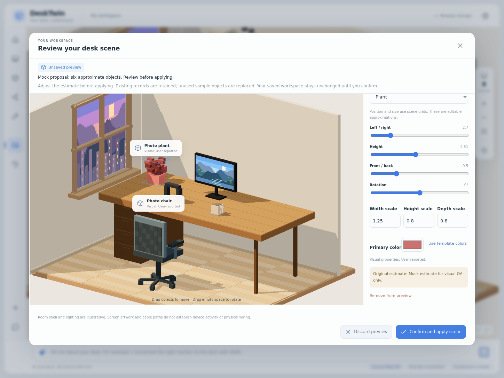
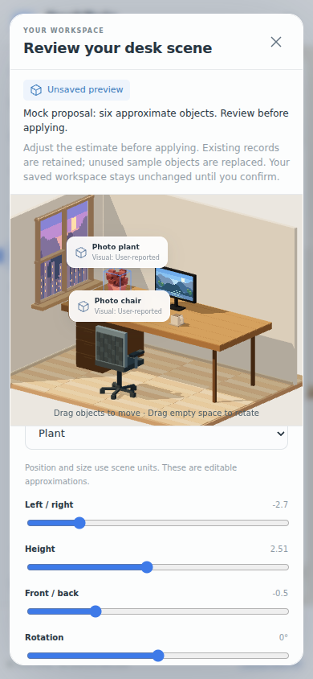

# Photo scene editor

DeskTwin turns a desk photo and the user's setup description into an editable voxel scene proposal. The proposal is a visual estimate. It does not reconstruct an exact mesh, measure physical dimensions, identify hidden wiring, or establish whether hardware works.

## User flow

1. Open **Desk photo** and choose a PNG, JPEG, or WebP image. Selection and local image processing do not send a request to Meta.
2. Add any known device or connection details in **Device and connection notes**. Existing saved device, connection, and scene object records also provide context. Free-text connection notes guide identification; they do not create connection records. Use **Record a connection** to save topology explicitly.
3. Check the separate photo consent checkbox and choose **Create scene preview with Meta**. The key remains on the local server.
4. Review the proposed scene in **Review your desk scene**. Select objects in the 3D view or the object list. Adjust position, height, yaw rotation, width/height/depth scale, and color. Change furniture templates or edit a generic object's box composition when needed. New candidates can be removed from the preview.
5. Choose **Confirm and apply scene** to save the reviewed configuration, or **Discard preview** to leave the saved configuration unchanged.
6. Use the scene object list and device list to select and edit objects later. Browser persistence, JSON export/import, Undo, and Redo include the scene data.

The preview displays retained user records alongside the proposed objects. Unused, disposable example devices and decor are replaced on approval. A sample device with a user-reported connection, a reported operating status, or an edited visual is retained so its evidence is not lost.

## UI preview from a mocked response

These are actual browser screenshots with synthetic input and a mocked scene proposal. They show the editing flow, not a successful live Meta analysis.

## Procedural templates and editable substitutes

The renderer reuses code-built voxel geometry. It does not need a separate downloaded asset for every observed object.

| Category            | Supported templates                                                            |
| ------------------- | ------------------------------------------------------------------------------ |
| Devices             | Laptop, monitor, dock, external SSD, router, keyboard, mouse, desktop          |
| Furniture and decor | Desk, chair, plant, lamp, books, mug, mat, shelf, picture, organizer, figurine |
| Unsupported objects | `generic`: an editable box, or a composition of up to 16 axis-aligned boxes    |

A generic box part has only local position, size, and color. The schema does not accept scripts, shaders, functions, expressions, asset URLs, or arbitrary model-generated geometry code. Unsupported shapes should be approximated and described as approximate in the object's note.

Named templates preserve a recognizable voxel silhouette. Scale changes their proportions; it does not generate a new detailed mesh. The room shell, floor, and window remain illustrative, fixed geometry. Screen artwork is decorative. Drawn cable curves represent saved connection records and are not recovered physical cable routes.

## Data and evidence

The canonical data lives in `src/domain/workspace.ts`. Workspace v2 retains the existing `devices`, `connections`, `history`, and `appearance` fields, and adds `objects` for non-device scene objects.

Both devices and scene objects have:

- `placement`: absolute scene position (`x`, `y`, `z`) and yaw rotation in degrees.
- `visual.scale`: separate dimensionless width, height, and depth multipliers.
- `visual.color`: an optional primary tint. `null` uses template colors.
- `visual.source` and `visual.note`: the origin of the visual properties and their explanation.

Devices keep separate identity `source`, operating `status`, and `statusNote` fields. Editing a photo-inferred device's size or color changes the visual source to user-reported; it does not turn the identity or operating status into an independently verified fact. The original visual note remains available after manual adjustments.

The photo response contract in `src/domain/sceneProposal.ts` contains visual properties only. It cannot propose connection records or operating status. A new photo device receives `source: photo-inferred`, `status: unknown`, and an empty status note in application code. A suggestion that matches an existing non-demo device updates its placement and visual properties while preserving its identity, status, and connection endpoints.

## Preview and confirmation boundaries

`buildSceneDraft()` constructs a separate workspace snapshot. Creating, adjusting, or discarding this snapshot does not write localStorage or alter the saved Undo stack. The draft makes decor visible so a previously hidden-decor preference cannot conceal the objects being reviewed.

`applySceneDraft()` compares the current saved workspace with the original preview base. If another edit, import, or Undo changed the saved workspace, applying the old preview is rejected. The user must discard it and analyze again. The function also rejects a draft that changes existing device reports or saved connection records.

Approval produces one saved snapshot and one change-history event. Temporary preview edits do not flood saved history. One Undo restores the complete previous workspace, and Redo restores the approved scene.

## Existing saves and JSON compatibility

`parseWorkspace()` accepts existing v1 JSON and migrates it to v2 in memory. It preserves device IDs, names, models, reported status, connection records, history, and appearance preferences. Existing device positions gain the previous default height and scale. The former fixed furniture and decor become editable example objects.

The localStorage key remains `desktwin.workspace.v1` so existing installations can find their saved workspace. The document stored under that key uses `schemaVersion: 2` after a new saved change. Loading and migrating alone do not overwrite the original saved document. New exports contain v2 data. The previous v1 application cannot read new v2 exports.

Migration and roundtrip coverage uses a literal v1 fixture in `tests/fixtures/workspace-v1.json`. Invalid imports fail before replacing the saved workspace. A successful import remains undoable.

## Bounds and coordinate meaning

| Data                     | Limit                                       |
| ------------------------ | ------------------------------------------- |
| Photo proposal           | 1-32 objects per response                   |
| Saved devices            | 40                                          |
| Saved non-device objects | 60                                          |
| Generic composition      | 0-16 boxes; zero means the default box      |
| Connections / history    | 100 each                                    |
| Undo snapshots           | 20, in memory                               |
| Position                 | x: -4.3 to 4.3; y: 0 to 5.5; z: -1.9 to 3.7 |
| Yaw rotation             | -180 to 180 degrees                         |
| Scale on each axis       | 0.1-3                                       |
| Box local position       | -3 to 3 on each axis                        |
| Box size                 | 0.02-6 on each axis                         |

The default desk is about 7.4 scene units wide, 3.15 deep, and 2.5 high. A tabletop object's base normally starts at y = 2.51. These units are layout coordinates, not measured meters or centimeters.

## Current limitations and validation boundary

- Rotation is yaw only. Objects cannot be tilted with pitch or roll.
- Objects are independent. Moving or resizing a desk does not automatically move objects resting on it. There is no collision detection, snapping, physical support constraint, or object parenting.
- Exact object identity, relative scale, occluded surfaces, and camera interpretation depend on the model's estimate and the user's corrections.
- Repeated photo analysis preserves non-demo props. There is currently no existing-object ID matching for furniture and decor, so another analysis can add duplicate props. Review or remove duplicates manually. Existing non-demo device references are supported, but a model that does not match a visible device can still propose a duplicate device.
- A model response cannot exceed the remaining saved workspace capacity. Invalid or oversized proposals are rejected without changing the workspace.
- The server adapter, schema checks, and user flow are tested with mocked provider responses. This implementation does not claim successful live Meta calls or measured photo reconstruction accuracy. See `VALIDATION.md` for the checks actually run.

Canceling analysis or closing the photo panel stops the browser from accepting that response. A request already sent to Meta may continue on the server/provider side and may incur charges. Cancellation cannot retract an already transmitted photo.
