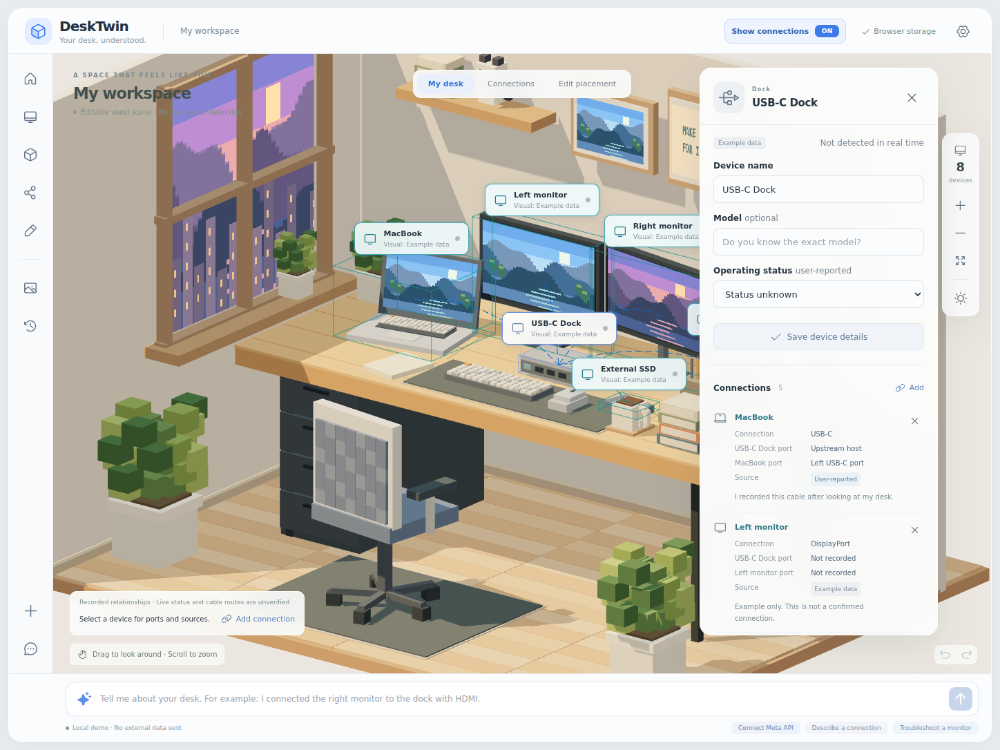
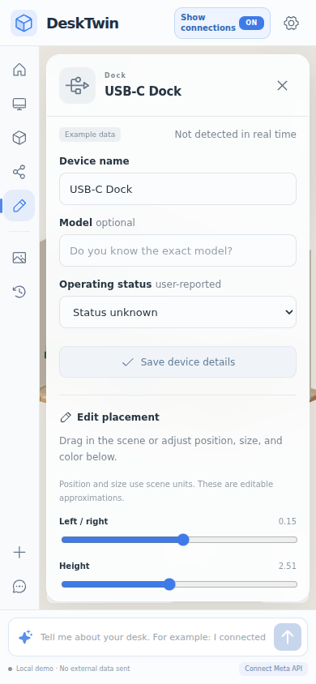
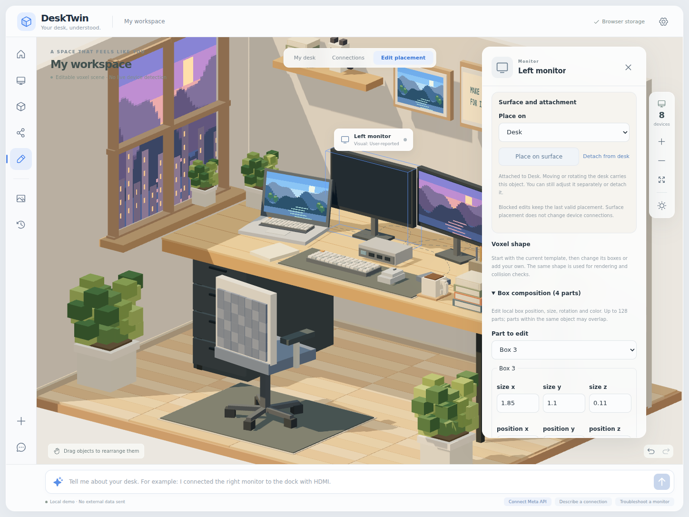
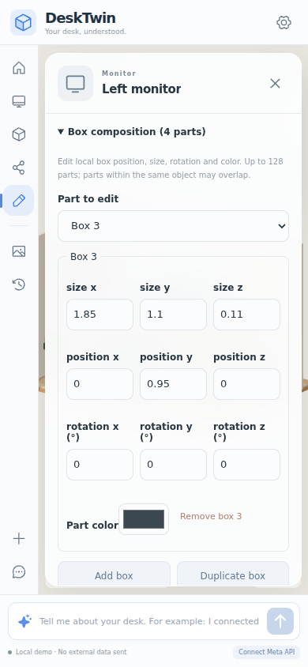

# Scene editing: placement, attachments and voxel shapes

DeskTwin keeps the existing procedural voxel style. Devices, furniture and props share the same validated scene model, geometry catalog and collision rules. Photos supply an editable visual proposal; they do not measure real dimensions, identify hidden wiring or verify hardware operation.

## View and Edit

**View** shows the complete desk and a fixed right inspector. Without a selection the inspector contains device/connection counts, user reports, devices needing attention and the separate Mac-recognition summary. Selecting a device shows its name, model, recorded ports/links, provenance, report note and OS status. A reported monitor issue can open the existing user-guided diagnostic flow there; no result is saved without the user's answer and explicit save.

**Edit** enables real dragging and the existing position, rotation, size, color and shape controls in the same inspector. Scene labels/popups are hidden while editing. Delete confirmation stays inside the panel. View/Edit switches preserve the selected record and its input drafts. On desktop, the panel occupies a separate grid column. On mobile, it sits below the scene and can collapse for more drag room.

Device name, model, user-reported status and note drafts also survive **My desk**, selection of another device, closing/reopening the inspector, and other panel navigation. **Unsaved device details** marks them separately from the saved record; **Resume editing draft** or the draft list reopens them. **Save device details** and **Discard draft** are explicit actions. View continues to show the saved evidence, so an unsaved working-status entry does not become a reported result.

These detail drafts exist only in the current open app, outside workspace storage, JSON export and automatic model context. Browser reload or tab close ends them. Loading another tab's saved workspace, importing or resetting requires review before an existing draft can be saved against the new records. Changed saved details and deleted/restored devices also require review. **Keep my edited fields after review** refreshes the baseline without saving; the user must then choose Save. See [draft lifecycle and transaction protection](STORAGE.md#device-drafts-and-navigation).

## Display recorded connections

The header's **Show connections ON/OFF** switch works in both **View** and **Edit**. Opening **View connections** turns it on; ordinary mode switches preserve the current toggle state. This is a view setting held in memory. It does not write connection records, create Undo steps, or change exported JSON.

ON displays every recorded relationship, including Bluetooth and Unknown connector records. Selecting a device emphasizes its incident lines and connected counterpart devices; other relationships remain visible with reduced emphasis. Selecting a desk, prop or empty space leaves all device relationships visible. OFF hides the lines while keeping recorded data, device details and counterpart emphasis available.

The device inspector shows the counterpart name, connector, each endpoint's entered port, source and note. Port labels follow the selected device even when it is the `to` endpoint of the stored edge. Missing port text is shown as **Not recorded**. Selecting the counterpart name opens that device.

View offers inspection and **Edit connections**. This action only enters Edit; it does not open an add form or save a change. In Edit, **Add** / **Record a connection** opens the existing user-reported connection form. A Remove action opens **Confirm removal / Cancel removal** within the right inspector. The record remains until confirmation; canceling or returning to View before confirming preserves it. Removing a record does not disconnect hardware, and Undo restores the saved relationship. The connection guide and overview follow the same mode boundary. Assistant connection proposals require **Edit to review connection**, then separate **Confirm and apply** approval.

Dashed arcs represent recorded relationships between visual object anchors. They are not measured cable paths or physical port positions. They do not indicate electrical connectivity, negotiated capabilities or successful hardware operation. Photo inference and example data keep their source labels. Dragging a device, or a desk carrying attached devices, updates these arcs during the unsaved gesture. The lines do not intercept object picking.

## Move and place objects

Open **Edit** (or the **Edit placement** navigation action) and select an object from the scene or **Scene objects**. Dragging uses the actual rendered box parts for collision checks. It stops at the last safe position instead of passing through another object. The empty space between desk legs remains usable. A fast pointer jump is swept along its path, including thin obstacles.

Position sliders, yaw rotation, axis scale and part edits also check the proposed shape. A blocked numeric edit keeps the prior saved value and shows a reason. Numeric text remains editable while typing `0.`, a minus sign, or a decimal; Enter or leaving the field commits it. Escape restores the saved value. Workspace and object names preserve spaces while typing and trim only when committed. Device details use their explicit **Save device details** form instead of these Enter/blur controls.

Resizing an object already resting on the floor or a desk preserves its actual bottom and any small existing support gap, as long as the saved position bounds permit that adjustment. This matters for templates whose origin differs from the bottom of their geometry. Template changes and part size/rotation edits also retain resting contact when the edit does not explicitly change the relevant position. Explicit height or part-position edits remain deliberate placement changes and are collision-checked as entered. This correction does not make floating objects fall or move an unattached object with a separate support.

Under **Surface and attachment**, choose **Floor** or a desk, then **Place on surface**. Placement uses the actual bottom of the object's geometry and the rotated/scaled desk top. If the object is outside the chosen desk footprint, the explicit surface action tries the desk center; if that location is occupied or the object is too large, it asks the user to move or resize it. It does not hide a collision. Ordinary dragging snaps to a nearby surface at approximately the current height; changing from floor to tabletop is an explicit surface action, not an automatic jump through the desk.

Thin horizontal mats and rugs are valid support layers. During horizontal dragging, a covering transition can lift, translate and rest on the destination surface. Every segment uses the same swept collision check as other movement, including clearance above the starting object. The renderer saves those checked intermediate waypoints as one undoable drag. This fixes keyboard, mouse, SSD and chair movement in the untouched default scene; no default positions are rewritten.

Support uses the actual projected part footprint. An empty corner of a rotated mat's bounding box cannot support an object. Thick mats, tilted custom parts and direct downward edits into the covering remain normal solid collisions. Explicit floor/desk placement and supported dimension edits respect a thin covering on the chosen surface. This is a bounded placement aid, not a gravity, balance or arbitrary stacking simulation.

The solver preserves overlaps already present in older saves, so reading a save does not silently rearrange it. A user can move an overlapping object outward, but cannot deepen the existing overlap or create a new collision. Hidden decor still belongs to the saved scene and remains solid; enable **Show furniture and decor** to see it when arranging objects.

The example coordinates established in the earlier scene-editing release are unchanged by this update. Existing saves and generated v1 migration furniture also retain their original placements; the mat/rug correction changes movement calculation, not stored initial coordinates.

## Attach objects to a desk

Select a monitor or prop, choose a desk under **Place on**, and select **Attach to desk**. Attachment places it on that desk and records a scene relationship. It does not create a cable connection or change operating status.

- Moving or rotating the desk moves its attached objects in the live drag and the saved result.
- Scaling the desk updates the children's offsets and support height. Their own dimensions stay unchanged.
- Moving an attached object separately changes its offset while retaining the attachment. It must remain over its desk; detach it to move elsewhere.
- **Detach from desk** preserves its current world position.
- Deleting the desk detaches its children and preserves them; Undo restores the complete relationship.
- If a desk or any carried object would hit another object, the whole movement stops together.

Attachments have one level: devices and non-desk props may attach to desks; desks cannot attach to other objects. The saved representation keeps world coordinates and `attachment.parentId`, making an export directly inspectable.

## Edit the shape

Every existing device or furniture template can be a starting point. Choose **Customize template shape** to copy its exact voxel boxes into editable data. Choose a box in **Part to edit**, then change its local position, dimensions, rotation around x/y/z, or color. **Add box**, **Duplicate box**, and **Remove box** build more complex silhouettes. At least one custom box must remain. **Restore template shape** is undoable.

An object can contain up to 128 boxes. Overlap between parts of the same object is intentional and allowed; collision checks compare the resulting shape against other scene objects. Editing a part color clears the overall tint so the individual color is visible. Full-object rotation remains yaw; individual boxes support pitch, yaw and roll.

| Category            | Templates                                                                      |
| ------------------- | ------------------------------------------------------------------------------ |
| Devices             | Laptop, monitor, dock, external SSD, router, keyboard, mouse, desktop          |
| Furniture and props | Desk, chair, plant, lamp, books, mug, mat, shelf, picture, organizer, figurine |
| Unsupported objects | Generic voxel substitute, editable with the same box controls                  |

`src/domain/geometry.ts` supplies the same geometry to rendering, template conversion and collision checks. No per-object downloaded asset is required. Template screen illustrations and lamp lights remain decorative. In custom mode the saved boxes replace the template; decorative screen artwork and lamp lighting are not additional editable parts or indicators of device activity.

Only bounded data is accepted. Scripts, asset URLs, shaders, expressions and executable model-generated geometry are not allowed.

## Historical editor images

The connection views below were captured for the 2026-10-28 scene-editing release. They predate the current fixed View/Edit detail dock and are retained as historical references, not current UI verification. They use example devices and a synthetic user-reported connection record. They do not show live hardware detection or photo recognition.

The following recovered spatial-editor checkpoint images show an attached monitor and its editable box composition before the independent connection switch was added. The placement and shape controls remain available in the current fixed inspector. Current screenshots and final integrated validation should be assessed separately in [Validation](VALIDATION.md).

## Photo workflow and duplicate prevention

1. Choose a JPEG, PNG, WebP or HEIC/HEIF photo in **Desk photo**. Selection, local conversion and resizing do not transmit it.
2. Add known device/connection notes and check the separate Meta transmission consent.
3. Choose **Create scene preview with Meta**. The server key stays out of the browser.
4. Review the unsaved scene and its object list. Include/exclude candidates independently, restore excluded edits, and use **Add missing object** for items the photo missed. Retained saved records remain distinct from photo candidates. Candidates are fitted in support order; unavailable surfaces and collisions require review instead of silently sending tabletop objects to the floor.
5. For a photographed device, review **Device record**. Explicit existing IDs, stable prior photo IDs and unique matching names suggest reuse of an existing record. When a same-type retained record exists but there is no unambiguous match, **Confirm and apply scene** is disabled until a record choice is made. Choose an existing compatible device or explicitly choose **Keep as a separate new device**. **Review device record** jumps to an unresolved candidate.
6. Compare the reference photo and selected 3D item. Approximate photo regions appear only when supplied by the model. Edit name/type for new candidates, presets, placement, support, attachment, shape and color, resolve outstanding issues, then **Confirm and apply scene**, or **Discard preview**.

A repeated proposal reuses compatible existing photo records and uniquely matching props instead of blindly appending them. Matching is a visual suggestion, not verified identity. Different names, changed candidate IDs or ambiguous identical devices can still require manual matching. Example devices with user-recorded connections, status, visual edits or attachments are retained and can be matched. An existing record retains its name, model, identity source, reports and cable endpoints. Rebinding a preview restores the prior record and moves only the visual association. A new photo device always has unknown operating status.

The model may use a template or supply up to 32 bounded boxes for any device or prop, not just generic objects. Those boxes describe a complete approximate replacement shape, and the same editor remains available before and after approval. Described connections provide context but are not automatically persisted as cables.

Trackpad and tablet device types, and wrist-rest, monitor-riser, laptop-stand and light-bar object types provide independent editing without changing old shelf geometry. Manually added candidates use user-reported provenance and do not receive an invented photo region. Excluding a matched candidate restores its existing record; it is not a saved-device deletion action. See [photo review](PHOTO_REVIEW.md) for the bounded live-test evidence, new behavior and remaining limitations.

## OS observations and scene placement

**Open Mac hardware** starts a separate local consent/review flow. A read-only observation does not create a 3D object or a connection by itself. Choose an existing record or **Add as a separate new device**, select a template if adding, review and confirm. A new item uses a collision-checked free position; macOS does not measure its real desk position or shape. Existing names, model, placement, connections and user reports are preserved when linking.

A display can be **OS detected** and **User reports an issue** at the same time. **Detection stopped**, **Status unavailable** and **Match again** do not mean physical removal. A successful scan can report **Not detected** only for a previously approved persistent identity that remains unambiguous. OS USB hierarchy is shown only with its source, separate from recorded cables. Bluetooth live detection is unavailable; manual Bluetooth records remain editable and visible.

The Mac native source, exact build/run procedure and physical-hardware test checklist are in [MACOS_HARDWARE.md](MACOS_HARDWARE.md). Linux fixture tests do not establish that path has run successfully on a Mac.

## Transactions and saved data

`buildScenePreview()` creates an isolated snapshot. Editing, matching or discarding the preview does not write localStorage or consume saved Undo steps. Approval checks the preview base, preserves existing device reports and connections, validates new/worsened collisions, and writes one saved snapshot with one history event. One Undo restores the entire prior workspace.

The storage layer compares the latest saved document under a cross-tab Web Lock immediately before every write. A stale tab keeps its visible copy and shows **Load latest saved workspace** and **Export this tab's copy**. It cannot overwrite newer data through an edit, Undo, import or photo approval. Prepared same-tab replacements also check their original base after queued edits. Failed saves do not close an approval dialog or display a successful result. See [Storage behavior](STORAGE.md).

Workspace `schemaVersion: 2` and the `desktwin.workspace.v1` storage key remain. Storage and JSON import/export use the plain workspace document without a revision envelope. Optional fields include `attachment`, `shapeMode`, device `parts`, per-box `rotation`, local `hardwareBinding` and durable `hardwareOrigin` provenance. Portable export and UI import strip the hardware binding, preserve approved labels/provenance, and require new local matching. Missing fields keep the old rendering behavior. v1 migration preserves device IDs, names, models, status, connections, history and appearance; it accepts legacy extra presentation fields and older drag coordinates, and resolves generated decor IDs without renaming user devices. Reading or migrating a document never saves it automatically.

Writes require Web Locks on a supported HTTPS or localhost browser. When unavailable, the editor reports the limitation and does not perform an unprotected write; JSON export remains available. This coordinates current DeskTwin tabs on the same origin, not older application versions or unrelated scripts writing directly to the storage key.

Current code reads old v1/v2 saves. Older application versions may reject new optional fields or custom shapes: forward export compatibility with an older app is not promised. Import accepts bounded JSON files up to 12 MB; browser storage quotas can still reject a large save, in which case the prior saved workspace is preserved.

## Bounded data

| Data                                     | Limit                                                 |
| ---------------------------------------- | ----------------------------------------------------- |
| Saved devices / non-device objects       | 40 / 60                                               |
| User-edited custom shape                 | 1–128 boxes                                           |
| Photo proposal                           | 1–32 objects; 0–32 boxes each; zero uses the template |
| Object position                          | x −4.3…4.3; y 0…5.5; z −1.9…3.7                       |
| Whole-object yaw / box rotation per axis | −180…180 degrees                                      |
| Object scale per axis                    | 0.1…3                                                 |
| Box local position / size per axis       | −6…6 / 0.005…10                                       |
| Connections / saved history              | 100 each                                              |
| Undo snapshots                           | 20 in memory                                          |
| Validated drag path                      | 512 waypoints; release and continue if reached        |
| Automatic free-placement search          | 4096 bounded candidates per object                    |

Units are scene coordinates, not measured meters or centimeters. The default desk is about 7.4 units wide, 3.15 deep and 2.5 high.

## Fixed elements and practical limits

- The room shell, window and lighting design remain fixed scenery. Collision checks cover the floor and editable scene objects; fixed wall/window meshes are not independent collision or editing targets.
- This is placement editing with collision prevention, not a gravity, balance, stacking or material simulation. Unattached objects do not fall or follow a resized/moved support automatically.
- Desk support uses its largest flat box. A custom desk with unusual tiers may need manual height adjustment; it does not infer several independently selectable support surfaces.
- Floor placement respects the nonnegative saved object origin. A legacy template whose lowest box starts slightly above its origin may retain a small gap, up to about 0.05 scene units.
- Numeric rotation/scale uses conservative sweeps and may reject a very tight movement; move to clear space first. Existing overlaps are not automatically repaired on load.
- Photos still need user correction for perspective, scale, occlusion and identity. The fitting search may reject a crowded proposal rather than overwrite retained objects or accept intersections.
- Live Meta authentication, structured-output compatibility and visual inference quality are unverified. All automated photo tests use mocks. Canceling the browser request cannot retract a photo already sent or guarantee upstream cancellation.

See [initial validation](VALIDATION.md) for the original test record and [PR #4 review fixes](PR4_REVIEW_FIXES.md) for the subsequent reproductions and verification.
